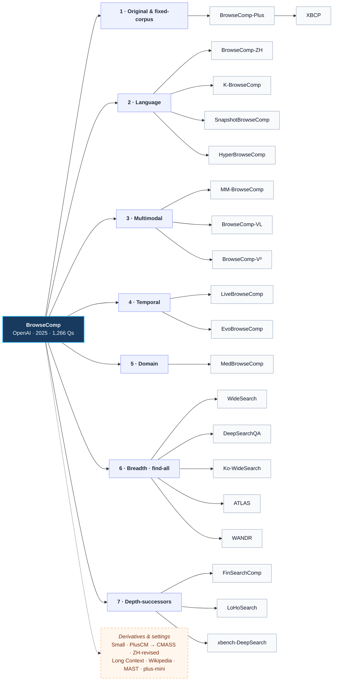
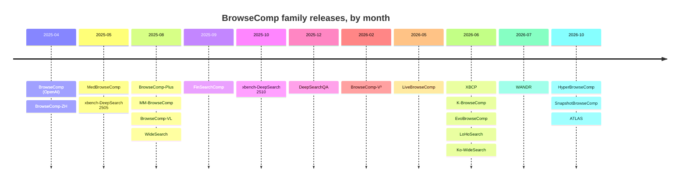
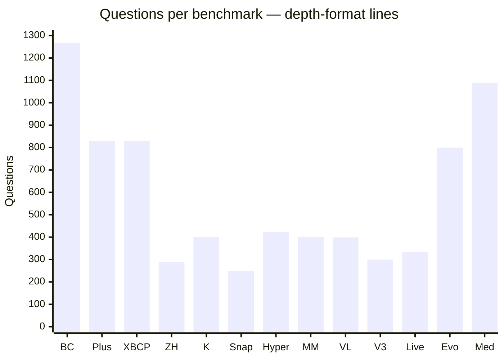
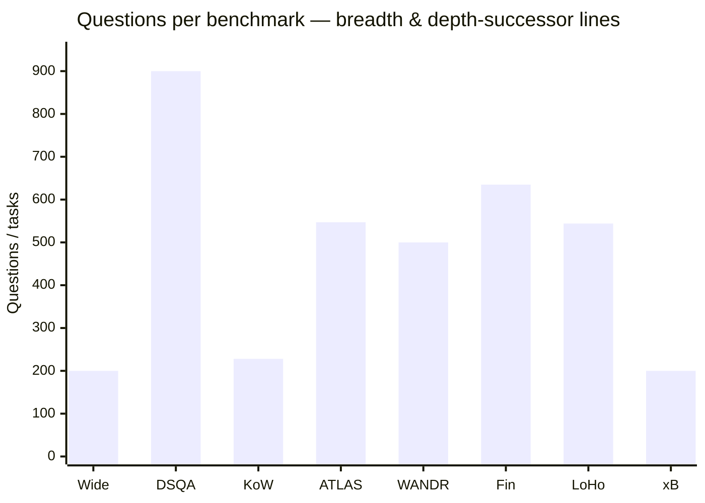

<p align="center">
  
</p>

<p align="center">
  <a href="https://awesome.re"></a>
  
  
  
  <a href="CONTRIBUTING.md"></a>
  <a href="LICENSE"></a>
</p>

> A curated catalogue of the **BrowseComp benchmark family** — every known variant, derivative and successor of OpenAI's BrowseComp for evaluating browsing and deep-research agents.
>
> 浏览类 / 深度研究智能体评测基准 BrowseComp 家族的完整清单：变体、衍生与后继工作。

**BrowseComp** (OpenAI, April 2025) set the template for a new kind of evaluation: short questions that are easy to check but hard to find — an agent must browse persistently, reason over what it finds, and return one exact answer. Within eighteen months the design had been re-implemented across languages, modalities, fixed corpora, live and time-sensitive settings, expert domains, exhaustive "find-all" answer sets, and deliberately harder successors. This list collects the whole family in one place: **21 independent variants + 7 derivatives/settings = 28 entries**, organised into seven lineage lines.

## Contents

- [Family tree](#family-tree)
- [Timeline](#timeline)
- [How this list is organised](#how-this-list-is-organised)
- [1. The original & the fixed-corpus line](#1-the-original--the-fixed-corpus-line)
- [2. The language line](#2-the-language-line)
- [3. The multimodal line](#3-the-multimodal-line)
- [4. The temporal line](#4-the-temporal-line)
- [5. The domain line](#5-the-domain-line)
- [6. The breadth line — exhaustive "find-all" search](#6-the-breadth-line--exhaustive-find-all-search)
- [7. The depth-successor line](#7-the-depth-successor-line)
- [Derivatives & evaluation settings](#derivatives--evaluation-settings)
- [Comparison table](#comparison-table)
- [A note on conflicting figures](#a-note-on-conflicting-figures)
- [Coverage notes](#coverage-notes)
- [Contributing](#contributing)
- [Citation](#citation)
- [License](#license)

## Family tree



## Timeline



## How this list is organised

**Independent variants** have their own questions, corpus or modality and an official paper, repository or dataset release. They are grouped into seven *lineage lines* by what they changed relative to the original:

| Line | What changed | Members |
|---|---|---|
| 1. Original & fixed-corpus | The template itself, then: freeze the web into a corpus so retrieval is reproducible | BrowseComp · BrowseComp-Plus · XBCP |
| 2. Language | New languages, natively written or evidence-side multilingual | BrowseComp-ZH · K-BrowseComp · SnapshotBrowseComp · HyperBrowseComp |
| 3. Multimodal | Evidence and answers require images / interleaved media | MM-BrowseComp · BrowseComp-VL · BrowseComp-V³ |
| 4. Temporal | Answers depend on recent facts, or questions regenerate from the live web | LiveBrowseComp · EvoBrowseComp |
| 5. Domain | Expert professional domains | MedBrowseComp |
| 6. Breadth (find-all) | The answer is a *set*: miss one, add one, or err on one and the item fails | WideSearch · DeepSearchQA · Ko-WideSearch · ATLAS · WANDR |
| 7. Depth-successor | Same single-answer format, aimed at the original's ceilings: saturation, expert depth, language/task coverage | FinSearchComp · LoHoSearch · xbench-DeepSearch |

**Derivatives & settings** reuse an existing variant's questions — subsets, answer revisions, corpus projections, shared-task projections, or a new evaluation context — and are listed separately so the counts stay honest.

Two inclusion rulings, applied consistently:

1. **Lineage is functional, not nominal.** A benchmark that drops the "BrowseComp" name but is built as exhaustive set retrieval and positions itself directly against BrowseComp-style single-answer deep search (e.g. WideSearch, DeepSearchQA) belongs to the family.
2. **When sources disagree, both figures are shown.** Question counts, corpus sizes and version differences are never silently merged — see [A note on conflicting figures](#a-note-on-conflicting-figures).

**How to read an entry.** `Size` = number of questions/tasks. `Env` = *Open web* (the agent browses the live internet) or *Fixed corpus* (a frozen document collection is provided). "Best reported" is the strongest result stated in the entry's own paper/release, under that work's own setup — scores are **not** comparable across entries.

---

## 1. The original & the fixed-corpus line

### BrowseComp — the original
- **Release:** 2025-04 · OpenAI
- **Size / format:** 1,266 questions · English · text · **open web**
- **Construction:** Human trainers wrote short questions with a single, verifiable, hard-to-find answer.
- **Best reported:** OpenAI Deep Research 51.5%.
- **Links:** [Paper](https://arxiv.org/abs/2504.12516) · [Code](https://github.com/openai/simple-evals)

### BrowseComp-Plus
- **Release:** 2025-08 · University of Waterloo
- **Size / format:** 830 questions (human-verified subset of the original) · English · text · **fixed corpus** of 100,195 documents
- **Construction:** Freezes the web behind the original questions into a static corpus with judged evidence documents, turning BrowseComp into a reproducible retrieval benchmark.
- **Best reported:** GPT-5 + Qwen3-Embedding-8B retriever, 70.1%.
- **Links:** [Paper](https://arxiv.org/abs/2508.06600) · [Code](https://github.com/texttron/BrowseComp-Plus) · [Data](https://huggingface.co/datasets/Tevatron/browsecomp-plus)

### XBCP — Cross-Lingual BrowseComp-Plus
- **Release:** 2026-06 · Waseda University
- **Size / format:** Same 830 questions (English questions & answers) · evidence documents in **12 languages** (5,040 documents) · **fixed corpus**
- **Construction:** Translates/projects the BrowseComp-Plus evidence set multilingually, isolating cross-lingual retrieval from question language.
- **Best reported:** 64.70% (original-language evidence) / 48.80% (multilingual) / 42.29% (cross-lingual).
- **Links:** [Paper](https://arxiv.org/abs/2606.15345) · No public code/data release.

## 2. The language line

### BrowseComp-ZH
- **Release:** 2025-04 · HKUST (Guangzhou)
- **Size / format:** 289 questions across 11 domains · Chinese · text · **open web**
- **Construction:** Chinese experts reverse-constructed questions from verified answers, targeting facts embedded in the Chinese web.
- **Best reported:** DeepResearch 42.9%.
- **Links:** [Paper](https://arxiv.org/abs/2504.19314) · [Code & data](https://github.com/PALIN2018/BrowseComp-ZH)

### K-BrowseComp
- **Release:** 2026-06 · Chung-Ang University
- **Size / format:** 400 questions = 300 Verified + 100 Synthetic · Korean · text · **open web** (non-text sources disallowed by design)
- **Best reported:** GPT-5.5 scores 45.67% on the Verified split.
- **Links:** [Paper](https://arxiv.org/abs/2606.02404) · [Code](https://github.com/prometheus-eval/K-BrowseComp) · [Data](https://huggingface.co/datasets/prometheus-eval/k-browsecomp)

### SnapshotBrowseComp
- **Release:** 2026-10 · Preferred Networks
- **Size / format:** 250 questions (lite 200 + hard 50) · Japanese questions · **fixed snapshot corpus** (8.2M Japanese + 45.5M English documents)
- **Construction:** Japanese BrowseComp-style questions answered against a frozen bilingual web snapshot. *No paper — the repository is the primary source; no scores reported.*
- **Links:** [Code](https://github.com/pfnet-research/snapshot-browsecomp) · [Data](https://huggingface.co/datasets/pfnet/snapshot-browsecomp)

### HyperBrowseComp
- **Release:** 2026-10 · MBZUAI
- **Size / format:** 423 questions (filtered from 500 candidates) · **13 languages, natively written (not translated)** · ~64.3% of questions require non-text modalities · **open web**
- **Construction:** Native-speaker authoring of hand-annotated multimodal questions in languages absent from prior benchmarks.
- **Best reported:** Gemini 3.7 Flash, 31.68%.
- **Links:** [Paper](https://arxiv.org/abs/2610.03574) · [Project page](https://HyperBrowseComp.github.io) · No public code/data release.

## 3. The multimodal line

### MM-BrowseComp
- **Release:** 2025-08 · ByteDance
- **Size / format:** **v1: 224 questions → v2: 400 questions (expanded Jan 2026)** · multimodal evidence · **open web**
- **Best reported:** o3 + tools 29.02% (v1); GPT-5-High + tools 24.25% (v2).
- **Links:** [Paper](https://arxiv.org/abs/2508.13186) · [Code](https://github.com/MMBrowseComp/MM-BrowseComp) · [Data](https://huggingface.co/datasets/mmbrowsecomp/MMBrowseComp)

### BrowseComp-VL
- **Release:** 2025-08 · Alibaba Tongyi (released with the WebWatcher agent)
- **Size / format:** 399 questions (Level 1: 199 + Level 2: 200) · multimodal · **open web**; the paper's evaluation samples 300 of them
- **Construction:** Automatically synthesised multimodal browsing questions at two difficulty levels.
- **Best reported:** WebWatcher-32B, 27.0% Pass@1.
- **Links:** [Paper](https://arxiv.org/abs/2508.05748) · [Code](https://github.com/Alibaba-NLP/WebAgent)

### BrowseComp-V³
- **Release:** 2026-02 · Peking University
- **Size / format:** 300 questions with 383 images · image–text **interleaved** evidence, with gold trajectories · **open web**
- **Best reported:** GPT-5.2-Thinking, 39.13% success rate.
- **Links:** [Paper](https://arxiv.org/abs/2602.12876) · [Code](https://github.com/Halcyon-Zhang/BrowseComp-V3) · [Data](https://huggingface.co/datasets/Halcyon-Zhang/BrowseComp-V3)

## 4. The temporal line

### LiveBrowseComp
- **Release:** 2026-05 · Harbin Institute of Technology
- **Size / format:** 335 questions in 8 categories · text · **open web**
- **Construction:** Every answer depends on facts that emerged within 90 days before the benchmark was built, defeating memorisation.
- **Best reported:** GPT-5.4 avg@4, 43.2%.
- **Links:** [Paper](https://arxiv.org/abs/2605.28721) · [Data](https://huggingface.co/datasets/Forival/LiveBrowseComp) · No code release.

### EvoBrowseComp
- **Release:** 2026-06 · Tencent WeChat AI
- **Size / format:** 800 questions (English 400 + Chinese 400) · bilingual · text · **live web, regenerable**
- **Construction:** A three-agent pipeline synthesises questions from the live web and can regenerate them, so the benchmark evolves instead of contaminating.
- **Best reported:** Claude Opus 4.8, 46.2% (English split).
- **Links:** [Paper](https://arxiv.org/abs/2606.13120) · [Data](https://huggingface.co/datasets/Krystalan/EvoBrowseComp) · No code release.

## 5. The domain line

### MedBrowseComp
- **Release:** 2025-05 · Harvard Medical School (AIM)
- **Size / format:** **1,000+ questions claimed; released splits total 1,089** = 605 deep-research (text) + 484 computer-use (GUI) · English · **open web + live software environments**
- **Construction:** Expert medical questions in two tracks: literature-style deep research, and computer-use tasks inside medical software.
- **Best reported:** o3 Deep Research scores 25.5/50 on a 50-question deep-research subset.
- **Links:** [Paper](https://arxiv.org/abs/2505.14963) · [Code](https://github.com/shan23chen/MedBrowseComp) · [Data](https://huggingface.co/datasets/AIM-Harvard/MedBrowseComp)

## 6. The breadth line — exhaustive "find-all" search

These benchmarks keep BrowseComp's verified-answer discipline but change the unit of success: the answer is a **set or table**. One missing, extra or wrong entry fails the item — they measure whether an agent knows *when to stop*.

### WideSearch
- **Release:** 2025-08 · ByteDance Seed
- **Size / format:** 200 questions (English 100 + Chinese 100), 15+ domains · answers are structured tables · **open web**
- **Construction:** Human-curated with a five-stage quality pipeline.
- **Best reported:** Most systems score ≈ 0% exact success; the best multi-agent system reaches ~5.1% — while item-level F1 can reach ~80%, the gap *is* the finding.
- **Links:** [Paper](https://arxiv.org/abs/2508.07999) · [Code](https://github.com/ByteDance-Seed/WideSearch) · [Data](https://huggingface.co/datasets/ByteDance-Seed/WideSearch) · [Project page](https://widesearch-seed.github.io)

### DeepSearchQA
- **Release:** 2025-12 · Google (DeepMind / Search / Kaggle / Research)
- **Size / format:** 900 prompts, 17 domains · the gold answer is a **set** · **open web**
- **Metrics:** Set-level F1 (primary) plus *Fully Correct* — the submitted set must equal the gold set exactly.
- **Best reported:** Gemini Deep Research Agent, F1 81.90 / Fully Correct 66.09%; GPT-5 Pro (High Reasoning) 78.98 / 65.18%. Failure modes split between stopping too early and spraying extra answers.
- **Links:** [Paper](https://arxiv.org/abs/2601.20975) · [Data](https://huggingface.co/datasets/google/deepsearchqa) · [Leaderboard](https://www.kaggle.com/benchmarks/google/dsqa/leaderboard) · No official code repository.

### Ko-WideSearch
- **Release:** 2026-06 · Upstage AI
- **Size / format:** 228 tables = 4,262 gold rows / 14,560 attribute cells, over 190 set-valued parent entities · 16 categories, 3 difficulty tiers · Korean · **open web**
- **Construction:** Automated *synthesize-and-verify* pipeline; data distributed **on request** (contamination control). Pipeline and scorer announced as MIT-licensed; no public repository URL found.
- **Best reported:** GPT-5.5 — Item-F1 92.8 vs Row-F1 53.7, whole-table success only 19.3%.
- **Links:** [Paper](https://arxiv.org/abs/2606.27595)

### ATLAS
- **Release:** 2026-10 · Exa
- **Size / format:** 547 tasks · find **all** entities (companies / people / places) meeting a condition, plus 2–10 attributes each, as a gold table · **open web**
- **Metric:** Row-F1 — a row counts only if every cell is right. 74% of tasks require ≥ 10 entities.
- **Best reported:** 0.66 row-F1 (best system); even the most expensive system misses ~1/3 of gold entities.
- **⚠️ Preview status:** as of early Nov 2026 the tasks, gold tables and scorer are **not public**; all numbers are vendor-run. A partial harness is available.
- **Links:** [Announcement](https://exa.ai/blog/atlas-benchmark) · [Harness (partial)](https://github.com/exa-labs/benchmarks) · No paper.

### WANDR
- **Release:** 2026-07 · Perplexity
- **Size / format:** 500 tasks (the HF mirror has 501 rows — see notes) backed by 170,495 sourced records · median task: 50 members / 245 records · **open web**
- **Scoring:** Reference-free — the scorer re-fetches cited pages; Soft/Hard F1.
- **Best reported:** Perplexity Search-as-Code, 0.363 Soft / 0.133 Hard F1.
- **Links:** [Paper](https://arxiv.org/abs/2608.14747) · [Code](https://github.com/perplexityai/wandr) · [Data](https://huggingface.co/datasets/perplexity-ai/wandr)

## 7. The depth-successor line

Same single-answer depth format as the original — each of these exists because BrowseComp hit a ceiling.

### FinSearchComp
- **Release:** 2025-09 · ByteDance Seed + Columbia Business School · ICLR 2026
- **Size / format:** 635 questions written/curated by 70 finance experts · global + Greater China markets · **open web**
- **Tasks:** Time-Sensitive Data Fetching / Simple Historical Lookup / Complex Historical Investigation — all with single deterministic answers from authoritative sources.
- **Best reported:** Grok 4 (web) leads the Global subset at 68.9% (still 6.1 pts below human experts); DouBao (web) leads Greater China, where every model trails humans by 34+ pts.
- **Links:** [Paper](https://arxiv.org/abs/2509.13160) · [Project page](https://randomtutu.github.io/FinSearchComp/) · [Data](https://huggingface.co/datasets/ByteSeedXpert/FinSearchComp)

### LoHoSearch
- **Release:** 2026-06 · Meituan LongCat
- **Size / format:** 544 human-verified questions, 11 domains, single unique answers · **open web**
- **Construction:** Built to break BrowseComp's saturation (top models ≈ 90%+): an automated pipeline over a 7.62M-entity / 265M-edge Wikipedia knowledge graph samples tree- and graph-structured constraint sets with KG-verified unique answers.
- **Best reported:** GPT-5.5, only 34.74%; correct trajectories need 1.7× more tool calls than on BrowseComp, and the best context-management strategy adds just +6.8 pts.
- **Links:** [Paper](https://arxiv.org/abs/2606.12837) · [Data](https://huggingface.co/datasets/meituan-longcat/LoHoSearch) · No official code repository found.

### xbench-DeepSearch
- **Release:** 2025 · xbench (AGI Tracking series)
- **Size / format:** **Two separate releases of 100 tasks each — 2505 (IDs 1–100) and 2510 (IDs 101–200)** · Chinese + English · **open web** · datasets encrypted against contamination
- **Best reported:** ChatGPT-5-Pro tops the official 2510 leaderboard at 75+ accuracy. *Scores are not comparable across the two releases — 2510 is substantially harder for trained agents.*
- **Links:** [Site & eval card](https://xbench.org) · [Code](https://github.com/xbench-ai/xbench-evals) · [Data](https://huggingface.co/datasets/xbench/DeepSearch-2510) · No arXiv paper.

---

## Derivatives & evaluation settings

Not independent benchmarks — each reuses an existing variant's questions. Listed for completeness; not counted in the 21.

### BrowseComp-Small
A 120-question sample of the original (train 60 + test 60) introduced by the ODR paper for cheaper iteration. [Paper](https://arxiv.org/abs/2508.10152) · [Code](https://github.com/EngDoLabadi/odrplus)

### BrowseComp-PlusCM → CMASS
Projects BrowseComp-Plus questions onto the 553M-document ClimbMix corpus. **v1 (Aug 2026, as "PlusCM"):** 57 questions fully grounded, evidence recall collapses 84.3% → 21.4%. **v2 (Oct 2026, renamed CMASS):** a four-source suite — Plus 80 questions / 11,450 qrels + Total Recall QA 68 + DeepSearchQA 71 + HotpotQA 204 = 423 questions / 40,736 qrels. Both the 57 and 80 figures circulate; they are different versions. [Paper](https://arxiv.org/abs/2608.20317) · [Site](https://cmass.tech) · [Code](https://github.com/castorini/cmass) · [Data](https://huggingface.co/datasets/castorini/cmass)

### BrowseComp-ZH-revised
The original 289 BrowseComp-ZH questions with 24 answers corrected by human re-annotation. LongCat reports Pass@1 69.0 / Heavy Thinking 77.7 on this revision. [Repository](https://github.com/AGI-Eval-Official/BrowseComp-ZH-revised)

### BrowseComp Long Context (128k / 256k)
An **evaluation setting, not a dataset** (OpenAI GPT-5 developer announcement, Aug 2025): the model answers from pre-fetched search results packed into a 128k/256k context, without browsing. It has no question count of its own — the 1,266 figure sometimes attached to it is the original's. GPT-5 (high) scores 90.0% / 88.8%.

### BrowseComp-Wikipedia
Projects 232 original questions (those answerable from English Wikipedia alone) onto a fixed Wikipedia corpus, as a retrieval task scored by Recall@k (SIRA: R@1 9.70% / R@10 15.27% / R@100 36.14%). Corpus size is reported two ways — 25,587,229 indexed documents (paper) vs 6,083,989 articles (independent reproduction) — both are shown in the entry's sources. [Paper](https://arxiv.org/abs/2605.06647) · [Code & data](https://github.com/facebookresearch/sira) (Meta Superintelligence Labs + Rice University)

### MAST — Multilingual Agentic Search Track (FIRE 2026)
A shared task that projects BrowseComp-Plus questions across languages — the mirror image of XBCP (MAST translates the *questions*; XBCP translates the *evidence*). Track 1: 50 questions × 15 languages; Track 2 (Indic): 50 × 9. Corpus and answers remain the English Plus set; scored by Recall + exact match; 43 runs / 15 teams in year one. [Site](https://mast-benchmark.github.io) · [Data: multilingual](https://huggingface.co/datasets/mast-benchmark/multilingual-queries-2026) · [Data: Indic](https://huggingface.co/datasets/mast-benchmark/indic-queries-2026) · No paper.

### browsecomp-plus-mini ⚠️ unofficial
A community (non-official) 15-question proxy of BrowseComp-Plus for cheap local evaluation, selected to preserve ranking fidelity with the full set (weighted Spearman 0.878 over 79 published runs). Uses normalised exact match instead of an LLM judge — scores are **not** comparable with the official benchmark. [Data](https://huggingface.co/datasets/LocalLLaMA/browsecomp-plus-mini) · No paper or code repository.

---

## Comparison table

| Benchmark | Year | Size | Language | Modality | Env | Best reported (own paper) |
|---|---|---|---|---|---|---|
| BrowseComp | 2025 | 1,266 | EN | Text | Open web | Deep Research 51.5% |
| BrowseComp-Plus | 2025 | 830 | EN | Text | Fixed corpus | GPT-5 + Qwen3-Emb-8B 70.1% |
| XBCP | 2026 | 830 | EN Qs, 12-lang evidence | Text | Fixed corpus | 64.70% / 42.29% (cross-lingual) |
| BrowseComp-ZH | 2025 | 289 | ZH | Text | Open web | DeepResearch 42.9% |
| K-BrowseComp | 2026 | 400 | KO | Text | Open web | GPT-5.5 45.67% (Verified) |
| SnapshotBrowseComp | 2026 | 250 | JA | Text | Fixed snapshot | — (none reported) |
| HyperBrowseComp | 2026 | 423 | 13, native | Multimodal (~64%) | Open web | Gemini 3.7 Flash 31.68% |
| MM-BrowseComp | 2025 | 224 → 400 | — | Multimodal | Open web | 29.02% (v1) / 24.25% (v2) |
| BrowseComp-VL | 2025 | 399 | — | Multimodal | Open web | WebWatcher-32B 27.0% |
| BrowseComp-V³ | 2026 | 300 | — | Interleaved | Open web | GPT-5.2-Thinking 39.13% |
| LiveBrowseComp | 2026 | 335 | — | Text | Open web | GPT-5.4 avg@4 43.2% |
| EvoBrowseComp | 2026 | 800 | EN + ZH | Text | Live web | Claude Opus 4.8 46.2% (EN) |
| MedBrowseComp | 2025 | 1,089 (claimed 1,000+) | EN | Text + GUI | Open web | o3 DR 25.5/50 (subset) |
| WideSearch | 2025 | 200 | EN + ZH | Text → tables | Open web | ~5.1% exact (best system) |
| DeepSearchQA | 2025 | 900 | EN | Text → sets | Open web | F1 81.90 / Fully Correct 66.09% |
| Ko-WideSearch | 2026 | 228 tables | KO | Text → tables | Open web | Row-F1 53.7, table success 19.3% |
| ATLAS | 2026 | 547 | EN | Text → tables | Open web | Row-F1 0.66 ⚠️ preview |
| WANDR | 2026 | 500 | EN | Text → sets | Open web | Soft F1 0.363 / Hard 0.133 |
| FinSearchComp | 2025 | 635 | EN + ZH markets | Text | Open web | Grok 4 (web) 68.9% (Global) |
| LoHoSearch | 2026 | 544 | — | Text | Open web | GPT-5.5 34.74% |
| xbench-DeepSearch | 2025 | 100 + 100 | ZH + EN | Text | Open web | ChatGPT-5-Pro 75+ (2510) |

*Derivatives are excluded from this table; see their section above. "—" = not specified in the source.*

### Sizes at a glance





*BC = BrowseComp · Snap = SnapshotBrowseComp · MM = MM-BrowseComp · VL = BrowseComp-VL · V3 = BrowseComp-V³ · DSQA = DeepSearchQA · KoW = Ko-WideSearch (counts tables; all others count questions/tasks) · xB = xbench-DeepSearch (two 100-task releases).*

## A note on conflicting figures

This family is young and fast-moving; sources genuinely disagree. This list preserves both numbers instead of picking one:

- **MM-BrowseComp:** 224 questions (v1, 2025) vs 400 (v2, Jan 2026 expansion).
- **BrowseComp-VL:** 399 questions released vs 300 sampled in the paper's evaluation.
- **MedBrowseComp:** "1,000+" claimed vs 605 + 484 = 1,089 across the released splits.
- **BrowseComp Long Context:** no question count of its own; 1,266 belongs to the original.
- **BrowseComp-Wikipedia:** corpus of 25,587,229 indexed documents (paper) vs 6,083,989 articles (reproduction's preprocessing).
- **WANDR:** 500 tasks (paper) vs 501 rows in the HF mirror.
- **PlusCM → CMASS:** 57 grounded questions (v1) vs 80 in the v2 suite — a version difference, not an error.
- **DeepSearchQA:** paper dated Dec 2025; the arXiv version is Jan 2026 (2601.20975).
- **xbench-DeepSearch:** two releases scored separately; never merge 2505 and 2510 results.

## Coverage notes

The catalogue was assembled by sweeping arXiv, GitHub and Hugging Face twice — once by name, once by functional lineage (renamed descendants) — in November 2026.

Checked and **not** existing as standalone releases (as of Nov 2026): Arabic / French / Spanish / Russian / Hindi / Japanese editions beyond SnapshotBrowseComp; DeepBrowseComp; BrowseComp-Hard / -Temporal / -Live / -Dynamic; BrowseComp 2; FreshBrowseComp; Fin/Legal/Sci/Code-BrowseComp as named releases.

Checked and **excluded**: DeepResearch Bench I/II and DRACO (long-report rubrics, not answer sets); InfoDeepSeek (single-answer, different lineage); AssistantBench (2024, predates BrowseComp); ORBIT (a training-data pipeline, not a benchmark); Total Recall QA (document-level total recall, single answer); unnamed vendor evaluation slices and leaderboard subsets; dataset mirrors, forks and run-output repositories.

*Caveat:* the sweep used search-indexed pages rather than exhaustive API enumeration of GitHub/HF; a release only days old or unindexed could in principle be missed. If you find one, please open an issue or PR.

## Contributing

Contributions are welcome — new variants, corrections, and updated results. Please read [CONTRIBUTING.md](CONTRIBUTING.md) first: entries need a primary source (paper, official repository or dataset page), and conflicting figures are presented side by side, never silently merged.

A machine-readable version of the catalogue is in [`benchmarks.json`](benchmarks.json).

## Citation

If this catalogue helps your work, please cite the original benchmark and, for the Chinese line, BrowseComp-ZH:

```bibtex
@article{wei2025browsecomp,
  title   = {BrowseComp: A Simple Yet Challenging Benchmark for Browsing Agents},
  author  = {Wei, Jason and others},
  journal = {arXiv preprint arXiv:2504.12516},
  year    = {2025}
}

@article{zhou2025browsecompzh,
  title   = {BrowseComp-ZH: Benchmarking Web Browsing and Information Seeking in Chinese},
  author  = {Zhou, Peilin and others},
  journal = {arXiv preprint arXiv:2504.19314},
  year    = {2025}
}
```

## License

[](LICENSE)

This list is released under [CC0 1.0 Universal](LICENSE) — public domain. All benchmarks, papers and datasets linked here belong to their respective authors.
